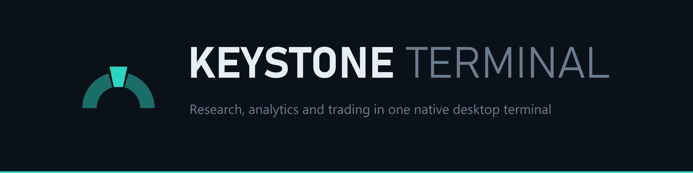
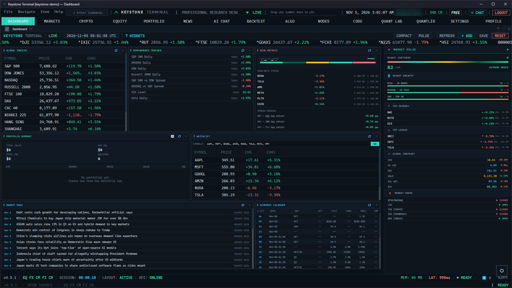
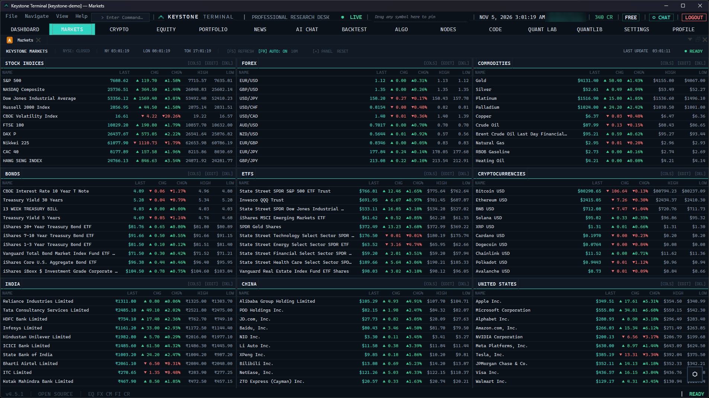
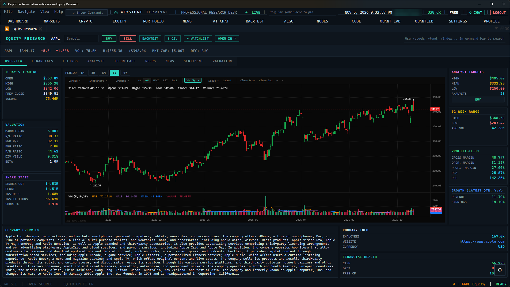
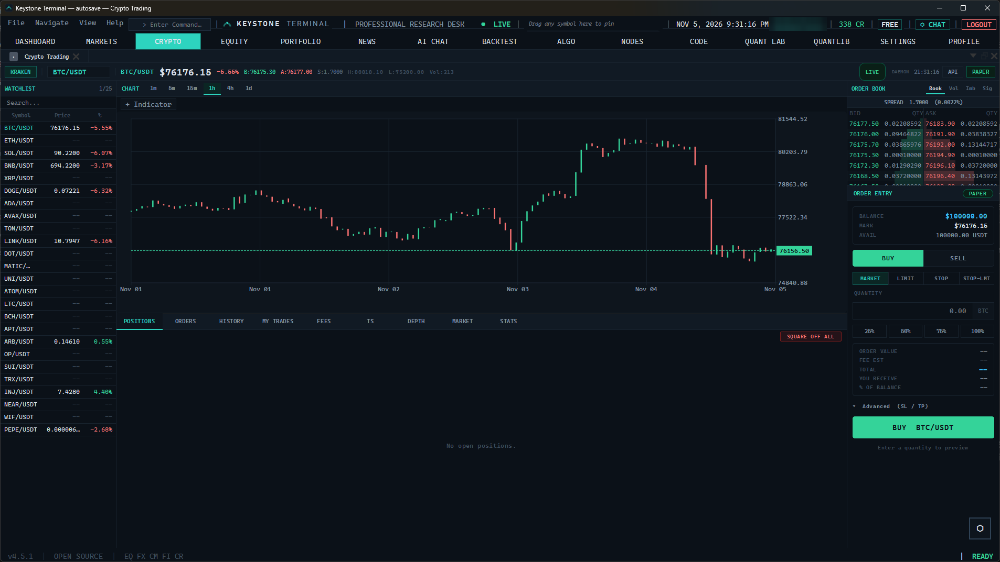
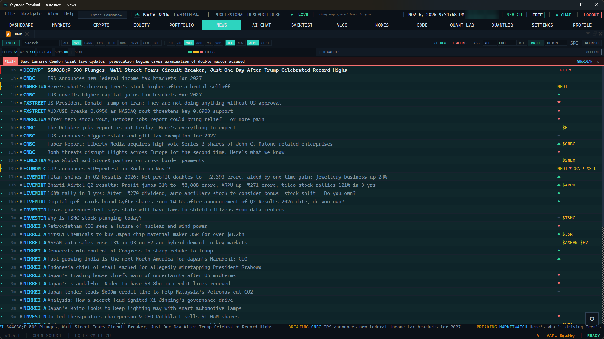
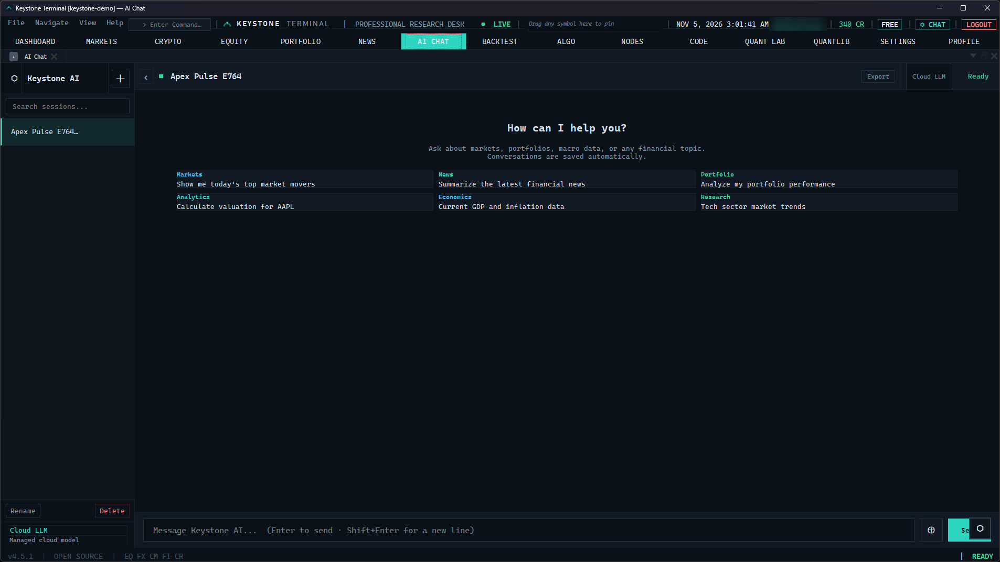
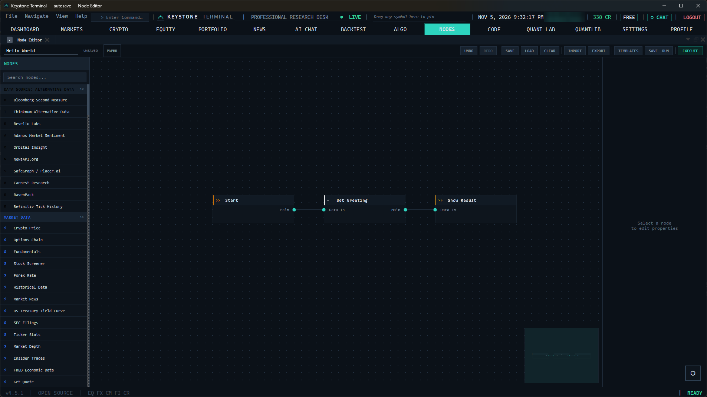
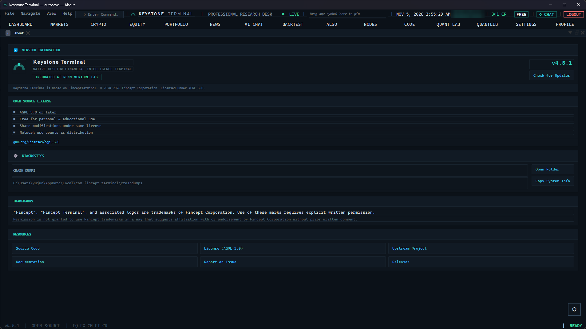
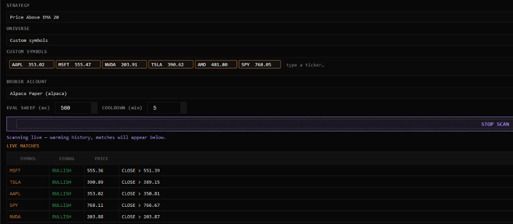

<div align="center">



### Research, analytics and trading in one native desktop terminal

**Incubated at Penn Venture Lab**

[](LICENSE)
[](https://isocpp.org/)
[](https://www.qt.io/)
[](https://www.python.org/)
[](#build-from-source)

[Overview](#overview) · [Screenshots](#screenshots) · [Features](#features) · [Engineering](#engineering-highlights) · [Build](#build-from-source) · [License](#license)

</div>

## Overview

Keystone Terminal is a desktop workstation for equity, crypto and macro research. It puts market
data, company research, charting, backtesting, AI-assisted analysis and paper or live trading
through your own broker into one native application: C++20 and Qt 6, embedded Python 3.11
analytics, one binary, no browser runtime.

It is built for analysts, research desks and students who want institutional-style tools on their
own machine, with their own data keys and their own models.

## Screenshots

<table>
  <tr>
    <td align="center" width="50%"><a href="docs/images/keystone-dashboard.png"></a><br/><sub><b>Dashboard</b></sub></td>
    <td align="center" width="50%"><a href="docs/images/keystone-markets.png"></a><br/><sub><b>Markets</b></sub></td>
  </tr>
  <tr>
    <td align="center" width="50%"><a href="docs/images/keystone-equity-research.png"></a><br/><sub><b>Equity Research</b></sub></td>
    <td align="center" width="50%"><a href="docs/images/keystone-crypto.png"></a><br/><sub><b>Crypto Trading</b></sub></td>
  </tr>
  <tr>
    <td align="center" width="50%"><a href="docs/images/keystone-news.png"></a><br/><sub><b>News</b></sub></td>
    <td align="center" width="50%"><a href="docs/images/keystone-ai-chat.png"></a><br/><sub><b>AI Chat</b></sub></td>
  </tr>
  <tr>
    <td align="center" width="50%"><a href="docs/images/keystone-node-editor.png"></a><br/><sub><b>Node Editor</b></sub></td>
    <td align="center" width="50%"><a href="docs/images/keystone-about.png"></a><br/><sub><b>About</b></sub></td>
  </tr>
</table>

## Features

- **Markets and research:** indices, FX, commodities, bonds, ETFs and crypto; company research with financials, filings, peers, valuation and sentiment
- **Analytics:** DCF, portfolio optimisation, VaR/Sharpe, derivatives pricing, fixed income, alternatives, plus an 18-module QuantLib suite
- **AI:** 37 trader/investor, economic and geopolitics agents; bring your own key (OpenAI, Anthropic, Gemini, Groq, DeepSeek, OpenRouter, Ollama)
- **Data:** 100+ connectors: FRED, IMF, World Bank, DBnomics, AkShare, Polygon, Kraken, Yahoo Finance, government APIs
- **Trading:** crypto and equity feeds, a paper-trading engine, 16 broker integrations
- **Automation:** visual node editor, MCP tools, AI Quant Lab (ML, factor discovery, RL)
- **Global intelligence:** maritime tracking, geopolitical analysis, relationship mapping

## Engineering highlights

Three pieces of engineering work stand out: streaming strategy evaluation in the algo engine,
a standalone market-data gateway, and a Python worker pool for the AI Quant Lab.

### Streaming strategy evaluation

This part reworks how strategy conditions are evaluated in the C++ algo engine: indicators are
kept as incremental state instead of being recomputed from scratch on every bar.

| | Before | After |
| --- | --- | --- |
| Backtest condition evaluation, EMA 12/26 cross, 20,000 bars | 1087 ms | 11.2 ms (97×) |
| Realtime scan sweep, 500 symbols | 3.6–5.6 ms | 0.28–0.50 ms (10–19×) |
| Live EMA(200) error in realtime scans, worst case | 4.38 % of price | 0 |
| Test executables | 4 | 8 |

Every step is checked bar by bar against the original engine (bit-identical where the
arithmetic allows), with mutation tests, characterisation tests written before the
refactor, and per-bar verdict checksums. Design, numbers and how to reproduce them:
**[docs/STREAMING_EVALUATION.md](docs/STREAMING_EVALUATION.md)**.

#### Checked against a live broker feed

The realtime scanner was then run in the app against the Alpaca paper account's IEX feed
("Price Above EMA 20", 15-minute bars, six symbols), with each match's EMA(20) recomputed
independently from Yahoo data. The live run caught what simulated feeds could not:
Alpaca history requests returned only the **oldest** 500 bars of the range
(`limit=500&sort=asc`, `next_page_token` ignored), so indicators warmed on history that
ended a month earlier. Fixed in
[`ac3a2306`](https://github.com/donbeatless-stack/KeystoneTerminal/commit/ac3a2306), then re-run:

| EMA(20) minus the independent value | Before the fix | After |
| --- | --- | --- |
| MSFT | −19.02 | +0.68 |
| TSLA | −12.54 | −0.90 |
| AAPL | −13.36 | +0.35 |
| SPY | match missed (price was above its EMA) | +0.42, matches |
| Warm-up history | oldest 500 bars, ending early October | 1,094–1,193 bars, up to the last finished bar |



The remaining 0.05–0.23 % is the data source: Alpaca's free feed carries IEX trades only.
Details: [Live check against a broker feed](docs/STREAMING_EVALUATION.md#live-check-against-a-broker-feed).

### Market-data gateway (`gateway/`)

A standalone C++20 service (Asio; IOCP on Windows) that fans one market-data feed out to
many TCP clients:
- **Ports:** a push port (8589) for long connections and a request port (8588) for one-shot queries.
- **Ingest:** a lock-free SPSC ring feeds a distributor thread, which sleeps when idle without losing wake-ups.
- **Slow consumers:** per-client conflating queues mean a slow consumer costs bounded memory and never delays anyone else.
- **Stats:** an HdrHistogram-style latency histogram.
- **Feed:** Alpaca's real-time stream, through a WebSocket client written for the gateway (RFC 6455 framing, TLS with certificate checks, ping-based liveness, reconnect with backoff, error handling by code), or a synthetic feed for benchmarks. Alpaca allows one stream connection per account, so the gateway holds it and fans it out.
- **Storage:** minute bars go into PostgreSQL through a connection pool written for the gateway. The pool caps connections (counting ones being opened), never holds its lock across a network round trip, health-checks idle connections and discards broken ones. A writer thread batches upserts, so the feed never waits on the database.
- **History for the terminal:** a sync keeps the stored minutes complete from Alpaca's REST API: a backfill, then a top-up each minute, paced under the rate limit, with backpressure from the database. A `HISTORY` query, answered on a worker pool through the connection pool, returns any intraday timeframe aggregated in SQL. It also says up to when the data is complete. The terminal's realtime scan warms from it, and falls back to the broker for whatever the gateway cannot vouch for.

| | |
| --- | --- |
| Pipeline latency, ingest → socket, 1 client | 7.4 µs p50 (4.2 µs with busy-poll) |
| Distributor throughput | 12.9 M deliveries/s on one thread |
| 5 slow clients among 50 | Fast clients unaffected (p99 336 µs vs 360 µs without); slow ones conflated to 11 % of ticks |
| Connection pool vs connecting per query | 0.084 ms vs 239 ms median with 8 threads; 37,500 vs 33 queries/s (local PostgreSQL 18.6, Windows) |
| Scan warm-up, 6 symbols, broker vs gateway | 0.59 s vs 0.21 s; the same bars, symbol for symbol |
| History for 504 symbols (S&P 500 + SPY), 55 days of 15m bars | 2.1 s from the gateway; the broker path needs 504 requests, at least 2.5 min on the free plan |
| Backfill, 504 symbols × 60 days of one-minute bars | 5.37 M bars in 252 s, 512 requests, no 429s |
| Tests | 138: unit, end-to-end over sockets, concurrency, fuzzing, the feed against a fake Alpaca server (dropped links, bad keys, the connection limit, dead links), the pool, bar storage and `HISTORY` against a real PostgreSQL (including a killed server session), the REST sync against a fake server; clean under AddressSanitizer; 9 deliberately planted bugs all caught |
| Live check | Alpaca's test stream over TLS 1.3: trades reached the request port, minute bars landed in PostgreSQL about 1.4 s after each minute closed |

Architecture, design trade-offs, the full benchmark matrix and its limits:
**[gateway/README.md](gateway/README.md)**.

### Python worker pool for the AI Quant Lab

The terminal ran every AI Quant Lab call as a new Python process, so each one paid for
the interpreter and its imports (qlib, PyTorch, statsmodels, scipy) before doing any
work: 2–18 s per call. The calls now run in warm worker processes:
- **A fresh process, as far as the script can tell:** the worker sets `argv`,
  `__main__`, `sys.path`, environment, working directory and stdin per call, then restores
  them and drops the scripts' own modules, so only third-party libraries stay loaded.
  No script was changed.
- **Failures stay contained:** a worker that crashes or overruns its deadline fails
  only its own call, with no retry (it may already have trained a model). When no worker
  can start, or a call waits 5 s behind busy ones, the call runs the old way.
- **Warm-up:** opening a module imports its script in a worker while the panel is
  being filled in.

| | |
| --- | --- |
| Repeat calls, 7 real Quant Lab calls | 9–30 ms in the worker vs 2.8–17 s in a fresh process (198–958×), byte-identical output |
| In the app, Statsmodels OLS | 33 ms, then 18 ms |
| Memory | a statsmodels worker commits 5.6 GB for 189 MB resident (three bundled OpenBLAS copies reserving per-thread buffers), so workers are recycled on resident memory |
| Tests | 18 cases against a real interpreter (Python 3.11, 3.12, 3.14); 9 of 11 deliberately planted bugs caught, the other 2 change nothing a script can observe |

Design, measurements and limits: **[docs/PYTHON_WORKER_POOL.md](docs/PYTHON_WORKER_POOL.md)**.

## Build from source

```bash
git clone https://github.com/donbeatless-stack/KeystoneTerminal.git
cd KeystoneTerminal
./setup.sh    # Linux / macOS
```

Windows and manual builds, the pinned toolchain (CMake 3.27.7, Ninja 1.11.1, Qt 6.8.3,
Python 3.11.9) and troubleshooting are in **[docs/GETTING_STARTED.md](docs/GETTING_STARTED.md)**.

## Contributing

[Getting started](docs/GETTING_STARTED.md) · [Contributing guide](docs/CONTRIBUTING.md) ·
[C++ guide](docs/CPP_CONTRIBUTOR_GUIDE.md) · [Python guide](docs/PYTHON_CONTRIBUTOR_GUIDE.md) ·
[Architecture](docs/ARCHITECTURE.md) · [Report a bug](https://github.com/donbeatless-stack/KeystoneTerminal/issues)

## License

**AGPL-3.0-or-later**, full text in [LICENSE](LICENSE). AGPL-3.0 is strong copyleft: if you
distribute a modified build, or run one as a service that other people reach, you must make its
complete source available under the same licence.

Keystone Terminal builds on the open-source FinceptTerminal project, © 2025–2026 Fincept
Corporation, used under AGPL-3.0. The Penn Venture Lab name is used with permission.
