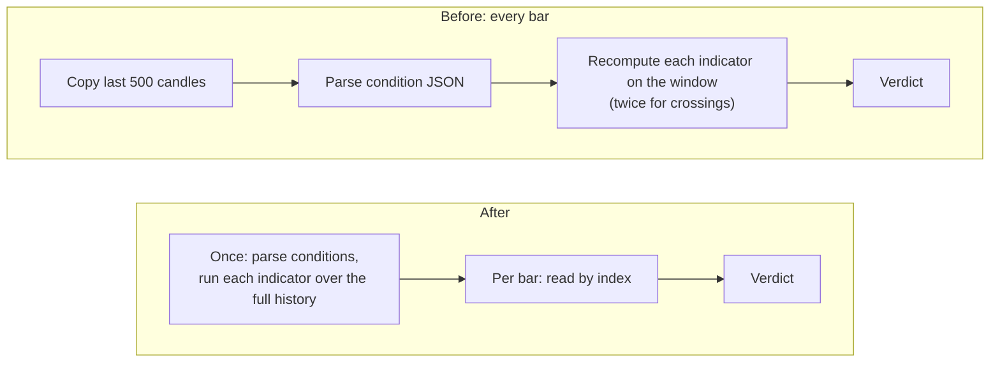
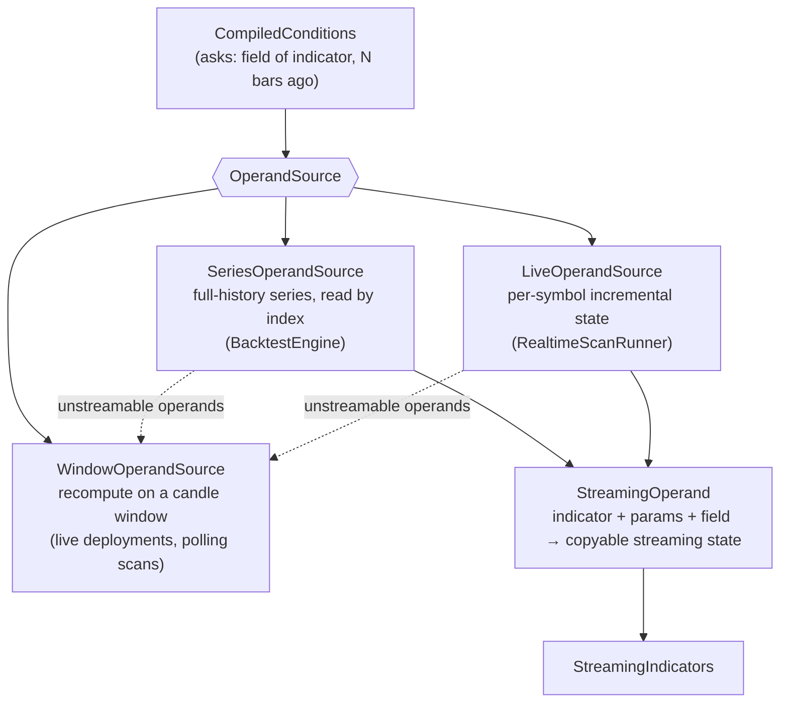

# Streaming strategy evaluation

Strategy conditions in Fincept Terminal ("close crosses above EMA(20)") used to be
evaluated by recomputing every indicator from scratch on every bar. This fork
replaces that with incremental (streaming) state: backtest condition evaluation is
**39–97× faster**, a realtime 500-symbol scan sweep is **10–19× faster**, and a
windowing defect that put a live EMA(200) up to **4.4 % of price** off is gone.
Every step is checked bar by bar against the original engine.

| Change | Measure | Before | After |
| --- | --- | --- | --- |
| Streaming indicators | EMA(20), time per bar | 6.1 µs | 3.4 ns |
| Backtest + parse-once conditions | EMA 12/26 cross, 20,000 bars | 1087 ms | 11.2 ms |
| Realtime scan | one sweep, 500 symbols | 3.6–5.6 ms | 0.28–0.50 ms |
| Realtime scan accuracy | EMA(200) worst error, % of price | 4.38 % | 0 |
| Tests | test executables | 4 | 8 |

Measured on an AMD Ryzen 9 8945HX (16 cores), Windows 11, MSVC 19.44, optimised
build. The benchmark programs are in `fincept-qt/tests/` — see [Reproduce](#reproduce).

## The problem



- **Cost.** `BacktestEngine` copied the trailing 500 candles on every bar and
  `ConditionEvaluator` called `IndicatorEngine::compute()` on that copy for every
  operand: O(window × operands) per bar.
- **Accuracy.** EMA, RSI, ATR and MACD are recursive. Recomputed on a window, they
  are re-seeded at the window start every bar, so the seed error keeps a weight of
  (1 − α)^k with α = 2 / (n + 1). For EMA(200) that is about 5 % in a 500-bar
  backtest window and about 58 % in the realtime scanner's 252-bar buffer.

## Architecture



| File | Role |
| --- | --- |
| `src/algo_engine/StreamingIndicators.{h,cpp}` | O(1)-per-bar SMA, EMA, RSI, ATR, MACD, Bollinger, Donchian, Stochastic, Williams %R, OBV, plus rolling z-score and annualised realised volatility |
| `src/algo_engine/StreamingOperand.{h,cpp}` | The one mapping from IndicatorEngine names, parameter defaults and fields onto streaming state; `clone()` for trial updates |
| `src/algo_engine/OperandSource.{h,cpp}` | The interface the evaluator reads through; `WindowOperandSource` is the original code, moved verbatim |
| `src/algo_engine/SeriesOperandSource.{h,cpp}` | Backtests: each distinct operand computed once over the history, then array reads |
| `src/algo_engine/LiveOperandSource.{h,cpp}` | Realtime scans: state over every closed candle; the two synthetic tick bars are applied to a clone |
| `src/algo_engine/ConditionEvaluator.{h,cpp}` | `CompiledConditions`: the condition tree parsed once; `evaluate_group(json)` = compile + evaluate |

### Streaming indicators

- **Bit-identical to the batch engine.** Floating-point addition is not
  associative, so each class mirrors the batch code's seeding (SMA-seeded EMA, Wilder
  RSI/ATR) and its exact operation order. With the test tolerance set to zero, SMA,
  EMA, RSI, ATR, MACD, the rolling extrema and OBV match bit for bit over 400 bars.
  CI keeps 1e-12 in case a toolchain contracts `a*b+c` into an FMA in one
  translation unit only.
- **Sliding Welford variance** for Bollinger, z-score and realised volatility, which
  avoids the catastrophic cancellation of Σx² − (Σx)²/n. A window of identical prices
  is detected exactly and reports variance 0, and an exact two-pass recompute runs
  every max(1024, window) pushes (amortised O(1)).
- **Monotonic deques** for rolling highs and lows: amortised O(1) per bar.
- **Non-finite ticks are ignored.** A recursive state that folds in a NaN carries it
  forever; the batch engine only suffered while the bad bar was in its window.

### Backtests

`SeriesOperandSource` serves streamable operands from series computed once over the
full history. Other indicators, unknown fields, VWAP and OBV fall back to the
original 500-bar window. VWAP and OBV stay on the window on purpose: both are
cumulative from the first bar of whatever window they are given, so a full-history
version would change what they mean. `CompiledConditions` then removed the
remaining per-bar cost, re-parsing the condition JSON. A constant-time operand source
showed that parsing was about 90 % of what was left.

### Realtime scans

`RealtimeScanRunner` fetched thousands of bars at warm-up but kept only
`required_bars + 50` of them. `LiveOperandSource` now takes the whole warm-up history,
then each live candle close. Each sweep runs the previous-tick and current-tick bars
through a clone of that state, so synthetic bars are never committed.
`CompiledConditions::operands()` lists what to track before the first sweep.
`DeploymentRunner`, which places orders, only parses its conditions once; its
values are unchanged.

### Behaviour changes, all intended

- Backtests and realtime scans using EMA, RSI, ATR or MACD now see full-history
  values. Short periods differ by about 1e-14; an EMA(200) cross strategy changes
  verdict on 147 of 20,000 backtest bars and on 5 of 500 symbols in a live sweep.
- Periods longer than the backtest window (e.g. SMA(600)) now warm up instead of
  never evaluating.

## Verification

| Check | What it pins |
| --- | --- |
| `tst_streaming_indicators` (19 cases) | Every bar of a 400-bar walk with a flat stretch and a gap equals `IndicatorEngine::compute` over the same history |
| `tst_series_operand_source` (6 cases) | Streamed operands equal the full-history batch result: value, error text, warm-up bar, at offsets 0, 1 and 5; finite-memory operands equal the old 500-bar window; unstreamable operands take the old path verbatim |
| `tst_live_operand_source` (4 cases) | Warm-up, intrabar ticks and closes replayed; streamed operands equal the full live window at offsets 0–3 with one or two tick bars |
| `tst_condition_evaluator` (15 cases) | Characterisation tests written and passing **before** the parse-once refactor: operators, offsets, errors, AND/OR short-circuiting, nested groups |
| Mutation testing | Planted bugs (ATR smoothing, extrema off-by-one, offset off-by-one, MACD default, ring-buffer read, tick index) each fail the expected tests |
| Verdict checksums | `bench_backtest_eval` hashes every per-bar verdict of six strategies; identical before and after the refactors |
| Builds | Zero warnings under `/W4 /permissive-`; the unity release build re-checked after every change |

Three upstream defects were fixed on the way: SHA-pinned FetchContent dependencies
with `GIT_SHALLOW` (fresh clones failed to configure), `tst_order_validator` not
compiling after `OrderValidator` gained settings I/O, and a missing `<QTimeZone>`
include hidden by the precompiled header.

## Reproduce

With the toolchain from `docs/GETTING_STARTED.md` (MSVC from a developer prompt,
Qt 6.8.3, CMake 3.27, Ninja, OpenSSL), in `fincept-qt/`:

```bash
cmake -B build/dev -G Ninja -DCMAKE_BUILD_TYPE=RelWithDebInfo -DFINCEPT_BUILD_TESTS=ON -DCMAKE_PREFIX_PATH=<Qt 6.8.3 kit> -DOPENSSL_ROOT_DIR=<OpenSSL>
cmake --build build/dev
ctest --test-dir build/dev
build/dev/tests/bench_streaming_indicators
build/dev/tests/bench_backtest_eval
build/dev/tests/bench_realtime_scan
```

## Known limitations

- The realtime scanner has been exercised with simulated feeds and benchmarks, not
  yet against a live broker feed in the app.
- `DeploymentRunner` still evaluates on its 500-candle window.
- `RealtimeScanRunner::required_bars` only reads `period` keys, so MACD with a long
  `slow` period can be under-buffered for operands that still use the window path.
- Z-score and realised volatility are in the library but not yet in the strategy
  builder's indicator list.
- Timings come from one machine; the benchmarks are in the repository to re-run.

## Commits

| Commit | Summary |
| --- | --- |
| `f9bef230` | build: drop `GIT_SHALLOW` from SHA-pinned QGeoView and ed25519 |
| `52ffb6be` | fix(trading): split OrderValidator risk-gate I/O so `tst_order_validator` builds |
| `79c55a91` | feat(algo): O(1) streaming indicators that match IndicatorEngine bar for bar |
| `e388d227` | perf(backtest): read condition operands from streamed series |
| `93d29a6c` | perf(algo): parse strategy conditions once with `CompiledConditions` |
| `b488dbf6` | perf(scan): evaluate realtime scans on full-history live operand state |
