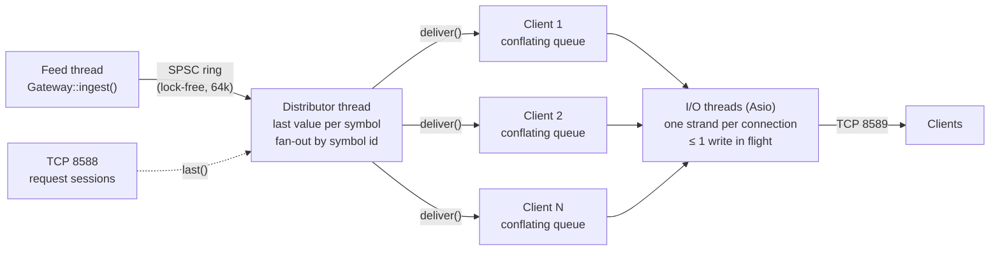

# fmdg: Fincept market-data gateway

A standalone C++20 service that takes in one market-data feed and fans it out to
many TCP clients, built around the cases that break naive fan-out servers: slow
consumers, bursty feeds, idle periods, and hostile input. The feed is
[Alpaca's real-time stock stream](#alpaca-feed) over a WebSocket client written for it,
or a synthetic feed for benchmarks. It keeps the dual-port layout of the original TMS
server, rebuilt on Asio (IOCP on Windows, epoll on Linux):

| Port | Connection | Purpose |
| --- | --- | --- |
| **8589** | long | Binary protocol: a client subscribes to symbols once, then updates are pushed to it |
| **8588** | short | Text: one request line in (`PING`, `SNAPSHOT <sym>...`, `STATS`, `FEED`, `HISTORY ...`), one reply out, connection closed |

## Contents

- [Architecture](#architecture)
- [Design decisions](#design-decisions)
- [Alpaca feed](#alpaca-feed)
- [Bar storage and the connection pool](#bar-storage-and-the-connection-pool)
- [History for the terminal](#history-for-the-terminal)
- [Live data for the terminal](#live-data-for-the-terminal)
- [Testing](#testing)
- [Performance](#performance)
- [Build and run](#build-and-run)
- [Limitations and next steps](#limitations-and-next-steps)

## Architecture



**Threads.**
- **Feed thread:** the single producer. It calls `Gateway::ingest()`, which stamps a sequence number and ingest time and pushes the tick into a lock-free single-producer/single-consumer ring.
- **Distributor thread:** drains the ring, records each symbol's last value, and hands the tick to that symbol's subscribers.
- **I/O threads:** run all socket work. Each connection's reads, writes and close run on its own Asio *strand*, so a connection's handlers never run concurrently and the session needs no lock of its own.

**Per-tick path.** `ingest` → ring → distributor → `PushSession::deliver` pushes the tick into the client's conflating queue and, if the client's writer is idle, posts a write onto its strand → `write_next` drains up to 256 ticks into one buffer → one `async_write`.

**Files.**

| File | What it is |
| --- | --- |
| `include/fmdg/spsc_ring.h` | Bounded SPSC ring: wait-free, each index and each cached copy on its own cache line |
| `include/fmdg/conflating_queue.h` | Per-client outbound queue, at most one pending tick per symbol |
| `include/fmdg/distributor.h` | Ring consumer, last-value cache, subscriptions, idle sleep/wake |
| `include/fmdg/latency_histogram.h` | Log-linear (HdrHistogram-style) histogram, ≤ 1/32 relative error, lock-free `record()` |
| `include/fmdg/protocol.h` | Wire format, bounds-checked parsers, stream `FrameReader` |
| `include/fmdg/symbol_table.h` | Symbol name ↔ dense id, capacity-capped |
| `include/fmdg/gateway.h` | Public API: `start`/`stop`/`ingest`/`stats`; config |
| `src/push_session.*`, `src/request_session.*` | The two connection types |
| `src/synthetic_feed.cpp` | Deterministic random-walk feed for demos, tests and benchmarks |
| `include/fmdg/ws_codec.h` | RFC 6455 client side: handshake helpers and frame codec, pure functions over bytes |
| `include/fmdg/alpaca_protocol.h` | Alpaca stream messages: outgoing JSON, simdjson parsing, what each error code means |
| `include/fmdg/alpaca_feed.h` | The Alpaca feed: TLS WebSocket session, heartbeat, reconnect supervisor |
| `src/tls_roots.cpp` | Loads the Windows root store into OpenSSL (which does not read it) |
| `include/fmdg/pool.h`, `pg.h`, `bar_store.h` | Connection pool, libpq wrapper, batched bar writer |
| `include/fmdg/history.h` | `HISTORY` on the request port: stored bars, aggregated in SQL |
| `include/fmdg/bar_sync.h`, `http.h` | Keeps the stored bars complete from Alpaca's REST API; HTTP/1.1 response parser |
| `src/net.h`, `src/http_client.h` | Shared TLS connection; GET over one kept-alive connection |
| `tools/loadgen.cpp` | Load generator and latency benchmark |

### Wire protocol (port 8589)

Every frame is an 8-byte header followed by the body. All integers are little-endian.

| Header field | Size |
| --- | --- |
| body length | u32 (≤ 64 KiB) |
| message type | u16 |
| flags | u16 (bit 0 on a Tick = snapshot) |

| Type | Direction | Body |
| --- | --- | --- |
| 1 Subscribe / 2 Unsubscribe | client → gateway | u16 n, then n × (u8 len, symbol) |
| 3 Subscribed | gateway → client | u16 n, then n × (u32 id, u8 len, symbol) |
| 4 Tick | gateway → client | u32 id, u64 seq, f64 price, f64 size, i64 exchange ts, i64 ingest ts, i64 send ts |
| 5 Heartbeat | both | empty; the gateway echoes it |
| 6 Error | gateway → client | u16 code, u8 len, text; the gateway then closes |

## Design decisions

**Slow consumers are conflated, not queued and not disconnected.** Each client has a
`ConflatingQueue`: while a symbol's tick is waiting to be written, a newer tick for that
symbol overwrites it in place (keeping its place in line). The trade-offs:

- A client that keeps up sees every tick.
- A client that falls behind costs at most one pending tick per symbol it follows, so memory is bounded no matter how long it stalls.
- The slow client never holds up anyone else.
- When it recovers it gets the *latest* value of every symbol, not minutes of stale history.

The alternatives are worse for market data: an unbounded per-client queue grows until
the process dies, and disconnecting slow clients turns a hiccup into a reconnect storm.

**A new subscriber gets the current value first, and sequence numbers never go backwards.**
A subscription immediately delivers each symbol's last value, flagged as a snapshot.
The ordering rule that makes this safe:
1. The distributor updates the last value *before* taking the subscription lock.
2. `subscribe()` delivers snapshots *while holding* that lock.

So a subscriber can see a tick twice, but never an older tick after a newer one. A
mutation test proves the rule matters (M5 below). Snapshots are excluded from the
latency statistics, because their age is not latency.

**Idle without burning a core, wake without a timer.** When the ring is empty, the
distributor spins briefly, then sleeps on a C++20 `atomic::wait`, which `publish()` ends
with `notify_one`. A naive version of this loses wake-ups: the consumer checks the ring,
the producer publishes and sees no sleeper, then the consumer sleeps forever. Here, both
sides write their flag, issue a `seq_cst` fence, and then read the other side's state
(Dekker style), so at least one of them sees the other. `busy_poll` skips the sleep for
the lowest latency.

**One write in flight per connection.** A session's `writing_` flag is set from the
moment a write is scheduled until the writer finds nothing left. `deliver()` posts a
write only when it flips that flag. The writer re-checks its queue after clearing the
flag, which closes the window where a tick arrives just as the writer goes idle
(mutation M3).

**Everything is bounded.**
- Symbols per request (1024), symbol length (32 printable ASCII characters), and frame body (64 KiB).
- Total symbols in the table (`max_symbols`): clients can name symbols, so without a cap one client could grow the table forever.
- Connections (`max_clients`).
- Request lines (4 KiB) and the request timeout (5 s).
- The ingest ring: when it is full, `ingest()` back-pressures the feed instead of dropping silently, and counts the waits.

**Request port closes gracefully.** After replying, the session half-closes and drains
input until the client closes, bounded by the timeout. Closing a socket with unread
input sends a TCP reset, and a reset can destroy a reply the client hasn't read yet.

**Not using Asio's `io_context` for the hot path.** The fan-out runs on a dedicated
thread fed by the ring, so a burst of ticks never competes with socket completions in
the same queue, and per-tick work on the distributor is a hash lookup and a mutex-guarded
queue push.

## Alpaca feed

`AlpacaFeed` connects to Alpaca's stock stream (`wss://stream.data.alpaca.markets/v2/iex`),
subscribes to trades and one-minute bars, and turns each trade into a `Tick` for
`Gateway::ingest()`. It runs on its own thread and `io_context`, as the gateway's single
producer.

**Why the gateway owns the upstream connection.** Alpaca allows one stream connection
per account on most plans; a second one is refused with error 406. The terminal and a
gateway cannot both connect, so the gateway holds the one connection and fans it out.
That is the reason gateways like this exist. The free plan also caps the stream at 30
symbols and offers only the IEX feed.

**Its own WebSocket client, on the same Asio.** Boost.Beast would bring Boost.Asio,
a second copy of the event loop next to the standalone Asio the gateway already uses.
`ws_codec` is RFC 6455 client framing as pure functions: a handshake builder and checker
(the server's `Sec-WebSocket-Accept` must match our key), a masking encoder, and a
decoder that takes bytes split anywhere. The decoder enforces what a client must: server
frames unmasked, no RSV bits, control frames unfragmented and ≤ 125 bytes, continuation
frames only inside a message. It also caps message size from the header alone, so a
hostile length fails before any payload is buffered. No extensions are offered, so
there is no compression to decode.

**One session.** resolve → TCP → TLS → upgrade, under one deadline; then the server's
`connected` → `auth` → `authenticated` → `subscribe`. Then a reader and a writer coroutine
run side by side, joined with Asio's `&&`, so whichever fails first ends the session and
cancels the other. Only the writer writes: auth, subscribe, pongs, pings and the
close reply all go through its queue, so the TLS stream never has two writes in flight.

**Following the clients.** `--alpaca-symbols` are always streamed. On top of them the
feed streams whatever push clients subscribe to, so a client such as the terminal can use
the gateway instead of the account's one stream connection
([Live data for the terminal](#live-data-for-the-terminal)).
- **Demand:** the distributor reports when a symbol gains its first subscriber or loses its last. The report only posts a note to the feed's thread. There the feed compares what clients want with what it streams, and sends Alpaca an `unsubscribe` for what nobody wants (first, so the cap has room), then a `subscribe` for the rest. `--alpaca-symbols` are never dropped.
- **Reconnects:** a new session subscribes to everything wanted at that moment, in one message.
- **Cap:** `--alpaca-max-symbols`, 30 on IEX (the free plan's limit). Symbols already streaming keep their place, so a new request never pushes out one someone is watching. The rest are counted (`skipped`) and logged.
- **Only stock symbols go upstream:** an upper-case letter, then letters, digits or dots. Above all this keeps out `*`, which would subscribe to every trade on the feed.
- `--alpaca-no-demand` turns it off: only `--alpaca-symbols` stream.

**Liveness by ping, not by silence.** Outside market hours an IEX symbol can go quiet for
minutes, so "no message for 15 s means dead" (the terminal's watchdog) reconnects a
healthy link over and over. The feed sends a WebSocket ping every 15 s and treats two
intervals without any byte, pong included, as a dead link.

**Errors by code.** Retrying a wrong key only hammers the server, so 402 (auth failed),
409 and 410 stop the feed for good. 406 waits a minute. 405 (symbol limit) is logged
and the session goes on, since earlier subscriptions remain. Anything else, including
dropped connections and timeouts, reconnects. The wait doubles per failure up to 30 s,
with 50–100 % jitter, and goes back to 1 s once a session has authenticated.

**TLS.**
- Certificate and hostname verification are on.
- OpenSSL on Windows does not read the system store, so `tls_roots.cpp` copies the Windows root certificates into it.
- Checked by trusting only an unrelated root (`--ca-file`): the handshake fails with "certificate verify failed".
- Credentials come from `APCA_API_KEY_ID` / `APCA_API_SECRET_KEY` or a file. Never from the command line, which other processes can read. Never logged; a test checks the log for the secret.

**Checked live** (2026-11-04, Alpaca's test stream, which publishes the made-up symbol
`FAKEPACA` around the clock):
- TLS 1.3; connected, authenticated and subscribed within the same second.
- First trade 3 s later; over 45 s, 8 trades and 1 minute bar, with no disconnects or errors.
- `SNAPSHOT FAKEPACA` on the request port returned the latest trade with its exchange timestamp.

## Bar storage and the connection pool

With `--pg`, the minute bars from the Alpaca feed go into PostgreSQL:

```
feed thread ── add() ──▶ in-memory queue ──▶ writer thread ──▶ Pool<pg::Connection> ──▶ bars_1m
            (never touches                  (batches of ≤ 1000 bars,
             the network)                    or whatever waited 1 s)
```

**`Pool<Conn>`** (`include/fmdg/pool.h`) is generic over the connection type, so its
rules are tested with fake connections and used with PostgreSQL ones.
- **The cap:** at most `max_size` connections exist, lent or idle, *including ones being opened right now*. The slot is reserved before the lock is released; otherwise every concurrent borrower of an empty pool sees room and opens its own.
- **Nothing slow under the lock:** opening, health-checking and closing a connection are network round trips, so they run with the slot reserved and the lock released. One slow connect never stalls a borrower who could take an idle connection.
- **Leases return themselves:** a `Lease` gives its connection back when it goes out of scope. `discard()` closes it instead, for a caller that saw it break. A lease may outlive its pool; the connection then closes on return.
- **Health:** a connection idle for `validate_after` (30 s) gets a `SELECT 1` before it is lent. One older than `max_lifetime`, or idle longer than `max_idle`, is closed. Borrowers wait at most `acquire_timeout`, then get `PoolTimeout`.
- **Wake-ups:** a failed open wakes a waiter, since its reserved slot is free again.

**`BarStore`** (`include/fmdg/bar_store.h`):
- **One statement per batch:** a multi-row `INSERT ... ON CONFLICT (symbol, start_ts) DO UPDATE`, so Alpaca's late corrections overwrite the bar they correct.
- **Corrections in the same batch:** a bar and its correction can land in one batch, and `ON CONFLICT` refuses to touch one row twice in a statement, so the batch is first reduced to the last version of each bar.
- **Values travel as parameters** (`PQexecParams`), never spliced into SQL. The table name is checked against `[a-z_][a-z0-9_]*`.
- **Failures:** a failed batch stays at the head of the queue and is retried with backoff. A connection that broke (SQLSTATE class 08, or a dead status) is discarded, not handed to the next borrower.
- **Outages:** while the database is down, bars wait in the queue (up to 500k; overflow drops the oldest and counts it). On shutdown each remaining batch gets one attempt, so a dead database cannot hold the process hostage.

**Why pool: measured.** `tools/pg_bench.cpp` runs the same parameterised round trip
(`SELECT $1::int + 1`) with a new connection per query and through the pool. Local
PostgreSQL 18.6, Windows 11, Ryzen 9 8945HX:

| | connect per query | pool | |
| --- | --- | --- | --- |
| 1 thread, median latency | 59 ms | 0.047 ms | ~1,200× |
| 8 threads, median latency | 239 ms | 0.084 ms | ~2,800× |
| 8 threads, throughput | 33 queries/s | 37,500 queries/s | ~1,100× |

A connection costs TCP setup, the startup exchange, SCRAM authentication, and on Windows
a new server process (PostgreSQL forks a backend per connection; Windows has no fork, so
each one is a fresh process start). Concurrent connects then queue on that. On Linux a
connection is typically a few milliseconds (not measured here), so the ratio would be
smaller, but connecting per query would still dominate a sub-millisecond query.

**Checked live** (2026-11-04, Alpaca's test stream, local PostgreSQL 18.6). Over 150 s:
- the feed delivered 24 trades and 2 minute bars;
- `bars_1m` received the 18:14 and 18:15 bars, each about 1.4 s after its minute ended;
- 2 batches, no failures, no drops, one pooled connection.

The test stream repeats made-up values, so the two bars carry the same prices.

## History for the terminal

A realtime scan warms its indicators on weeks of history before it watches live ticks.
Through the broker that is one REST request per symbol. Alpaca's free plan allows 200 a
minute, so a 500-symbol universe needs at least 2.5 minutes, or meets 429s if the
requests go out at once. The gateway keeps that history itself and answers in one round
trip:

```
Alpaca REST ──BarSync──▶ BarStore ──▶ bars_1m ◀──HISTORY (worker threads, pooled reads)── terminal
 (backfill, then a        (batched                                      ↑
  top-up each minute)      upserts)                       falls back to the broker for
                                                          anything the gateway can't vouch for
```

**`HISTORY <tf> <from> <to> <symbols>`** on the request port.
- **Aggregation in SQL:** only one-minute bars are stored. Longer periods are built in SQL: `date_bin` for the bucket, then first/max/min/last/sum.
- **Alignment:** buckets are aligned to the Unix epoch, so 15m bars fall at :00/:15/:30/:45 UTC, like Alpaca's own bars and the terminal's live aggregator.
- **Whole periods only:** a range that starts inside a period begins at the next one, so no bar is built from part of its minutes.
- **Off the I/O threads:** the query runs on a worker pool through the connection pool, so the I/O threads stay free. A test with a single I/O thread checks that `PING` is answered while a slow command runs.

**`BarSync`** keeps the stored minutes complete.
- **Backfill:** at start, `--sync-days` of one-minute bars for `--sync-symbols`, resuming where the store ends.
- **Top-up:** five seconds after each minute, the newest bars for all symbols, 100 symbols per request, re-reading the last two minutes for late-trade corrections.
- **Pacing:** 150 requests a minute. A 429 waits for `Retry-After`; network errors, timeouts and 5xx retry with backoff; 401/403 and other 4xx stop it.
- **Backpressure:** REST delivers far faster than the database writes rows. A 504-symbol backfill would overflow the store's queue, which drops its oldest bars. So the sync stops fetching while more than 100k bars wait, and resumes at half that.

**Completeness is reported, not assumed.** The reply header carries `complete_to`: every
synced symbol's minutes before it are stored.
- **It only advances once the store has written a pass's last bar**, not when the bar is fetched.
- **Synced symbols only:** a symbol only the live stream writes may have gaps, so `HISTORY` leaves it out.
- **The terminal** (`fincept-qt/src/algo_engine/GatewayHistory.h`) uses the gateway's bars only when `complete_to` is within 5 minutes of now. It drops periods that end after `complete_to`, and requires a symbol's history to reach back to the requested start. Everything else, and everything when the gateway is down, goes to the broker as before.

**Checked live** (2026-11-04, after hours, S&P 500 + SPY, local PostgreSQL 18.6):
- **The backfill:** 60 days of one-minute IEX bars for 504 symbols, 5,365,688 bars, took 252 s and 512 requests, with no retries and no 429s. After that, `complete_to` advanced every minute.
- **Broker vs gateway:** the same 6-symbol scan (`Price Above EMA 20`, 15m), warmed once through the broker (`FINCEPT_GATEWAY=off`) and once through the gateway:

| | broker REST | gateway |
| --- | --- | --- |
| Warm-up (scan start → all symbols warmed) | 0.59 s | 0.21 s |
| Bars per symbol over the broker's window | 1103–1201 | the same, symbol by symbol |
| Sum of the last 500 closes, last close | — | identical to 4 decimals, all 6 symbols |

So the 15m bars the gateway builds from minutes are the bars the broker returns.

- **`HISTORY`, 55 days of 15m bars, measured from a client.** Requests go 200 symbols each, in parallel, as the terminal sends them; median of 3:

| Symbols | Bars | Reply | Time |
| --- | --- | --- | --- |
| 6 | 6,791 | 0.3 MB | 146 ms |
| 50 | 50,716 | 2.4 MB | 596 ms |
| 200 | 201,301 | 9.6 MB | 1.6 s |
| 504 | 507,876 | 24.2 MB | 2.1 s |

The broker path for 504 symbols was not timed. It is 504 requests, so at least 2.5 minutes
under the free plan's limit, which is what the gateway removes.

Where the time goes, from `EXPLAIN ANALYZE` on one 200-symbol request: 1.49 s of its
1.6 s is the query itself.
- The index scan over about 2 million minute rows: 0.67 s.
- The sort and the aggregation: the rest.

The table holds 5.37 million rows in 648 MB. A 15-minute rollup table maintained on every
write would turn that into a scan of a fifteenth of the rows; it is the next optimisation
if warm-up time matters.

## Live data for the terminal

Alpaca allows one stream connection per account, so the terminal and a gateway cannot
both stream. When a gateway streams live trades, the terminal now takes them from the
push port and never opens its own Alpaca socket; the gateway subscribes upstream to
whatever the terminal asks for ([Following the clients](#alpaca-feed)).

```
Alpaca stream ◀─subscribe / unsubscribe─┐
      │                                  │  what push clients want, within the symbol cap
      ▼                                  │
  AlpacaFeed ──▶ gateway ──push 8589──▶ GatewayFeed ──▶ AccountDataStream ──▶ quotes, watchlists, scans
                    ▲                   (terminal)
                    └──── FEED on 8588: is there a live feed to rely on?
```

**Choosing the source** (`fincept-qt/src/trading/gateway/GatewayFeed.h`). For an Alpaca
account the terminal first sends `FEED` to the request port.
- **Use the gateway:** `FEED alpaca stream=iex` (or `sip`) in any state but `stopped`. The gateway holds the account's stream, or is about to. Then the terminal connects to the push port.
- **Use its own stream, exactly as before:**
  - nothing listening;
  - a history-only gateway (`FEED none`, started with `--feed none`, which still listens on 8589);
  - an older gateway (`ERR unknown command`);
  - the test or delayed stream;
  - a stopped feed (a bad key).
- **How long the fallback takes:** the first attempt's 1 s timeout. On Windows a port nobody listens on is refused only after about 2 s of SYN retries (2.1 s measured on loopback), so the timeout ends it. The timeout is not shorter because the UI thread is busy at start-up, and a false "no gateway" would send the terminal to Alpaca against the gateway's connection.
- **Once connected:** a dropped link is retried with backoff (0.5 s, doubling to 10 s, 50–100 % jitter). After 30 s without a connection the terminal falls back to its own stream until its account stream restarts. The limit is checked after each failed attempt, so the switch can come one backoff later (35.7 s in the check below).
- **Liveness:** a heartbeat every 5 s, which the gateway echoes. Three intervals with no byte at all mean a dead link.
- **Switches:** `FINCEPT_GATEWAY=off` turns the gateway off altogether. `FINCEPT_GATEWAY_FEED=off` keeps history from the gateway but the live feed on the broker. `FINCEPT_GATEWAY_FEED=host:port` points at another push port.

**Subscriptions** are a set. A change goes out as the `Subscribe`/`Unsubscribe` difference,
and a new connection subscribes the whole set again. Symbols the gateway would reject
(it closes the connection on one) never go out.

**What the terminal gets: trades.** Each one carries a last price and an exchange time.
- **Duplicates dropped:** a trade seen twice (a snapshot racing a live tick: the sequence is not newer) is dropped. So is a snapshot no newer than the quote already shown, which is what a reconnect sends.
- **No quotes on this path:** the gateway carries no quotes, so in gateway mode bid/ask are cleared rather than left stale. The paper order matcher then prices on the last trade, as it does whenever bid/ask are missing.
- **No bar fields:** the one-minute bar fields of a quote are not updated either. The realtime scan builds its own bars from the trades.

**Checked in the app, after hours** (2026-11-05, release build, Alpaca paper account, the
realtime scan from [History for the terminal](#history-for-the-terminal): `Price Above EMA 20`, 15m, six symbols):
- **Onto the gateway:** 16 ms from the scan starting the account stream to the terminal being on the push port, the FEED question included.
- **Upstream:** in the same second the gateway subscribed the six symbols on Alpaca, which confirmed them; `FEED` then reported `upstream=6`.
- **Warm-up:** from `HISTORY`, 6 of 6 symbols in 177 ms.
- **No second connection:** the terminal's log has no `AlpacaWS` line; it never opened its own stream.
- **Gateway killed:** the terminal saw the drop within 0.4 s and retried. After 35.7 s without a connection it switched to its own stream. That stream checked Alpaca's clock, found the market closed, and waited for the open, as before.

**Checked in the app, market hours** (2026-11-06, 15:42–16:00 ET, same scan). There were
three runs, and each warmed from the gateway's `HISTORY`. Every `FIRE` line was then
checked against the gateway's own one-minute IEX bars with
[`tools/live_check/scan_ab_check.py`](../tools/live_check/scan_ab_check.py).

How the check works:
- The scan compares the last price with an EMA(20) of the closed 15m bars plus the
  previous and the last tick.
- So the EMA it prints gives away the price it used.
- That price must lie in the range the symbol traded in over the two minutes before.

| Run | Live data | Start | Fires | Backed by a trade price |
| --- | --- | --- | --- | --- |
| 1 | gateway | app just launched | TSLA, AMD | 2 of 2 |
| 2 | own stream (after the fallback below) | scan restarted | TSLA, AMD, NVDA | 2 of 3 |
| 3 | own stream (`FEED none`) | app just launched | TSLA, AMD, NVDA, AMD, TSLA, SPY, AAPL, MSFT | 4 of 8 |

- **Gateway run:**
  - **Startup:** the terminal was on the push port 29 ms after its account stream started. The gateway subscribed the six symbols upstream in the same second.
  - **Warm-up:** 6 of 6 from `HISTORY` in 173 ms. In every run, each symbol's bar count and last-500-closes sum matched the gateway's bars.
  - **No second connection:** no `AlpacaWS` line in the log.
  - **Throughput over 4 minutes:** 2,745 trades came in and 1,817 were delivered (928 conflated).
  - **Latency inside the gateway:** p50 37 µs, p99 74 µs, p99.9 221 µs. No protocol errors.
- **Fallback with the market open:**
  - The gateway was killed at 15:46:21. The terminal saw the drop 0.5 s later.
  - It was on its own stream after 35.0 s.
  - Connecting, authenticating and subscribing the six symbols took 0.36 s.
- **Same signals where the trades say so:** in every run, the symbols whose trades were above the EMA (TSLA, AMD) fired, and no such symbol was missed.
- **Fires with no trade behind them, own stream only:**
  - Six of the own stream's 11 fires had no trade price behind them: NVDA at 15:50 and 15:55, TSLA at 15:59, and SPY, AAPL and MSFT at 16:00:01, just after the close.
  - For example, NVDA fired above 187.69 while it traded at 186.15–186.83.
  - The reason: that stream's last price includes IEX quote midpoints, `(bid+ask)/2`, and IEX's book can be wide, most of all at the close.
  - The gateway path passes trades only, so this cannot happen there.
- **One startup race, not caused by the gateway:**
  - In run 1 the EMA values fit only if the price went in three times, not twice: once more as an extra closed bar.
  - The cause is in the terminal. When the scan opens its quote feeds before the stream is up, `AccountDataStream::set_active_feed` fetches REST quotes. `AlpacaBroker::get_quotes` stamps them in seconds, and the scan reads them as milliseconds.
  - That quote opens a bar dated January 1970, which the first live tick then closes into the EMA.
  - Whether this happens is a race: the REST reply must arrive before the first tick. On the own stream, IEX quotes arrive within 0.1 s of connecting, so they win. On the gateway path, the first trade waits for the upstream subscribe, so the REST reply wins.
  - The extra bar sits at about the live price, so it moved the EMA by cents.
  - **Fixed the same day**, in two places:
    - `AlpacaBroker` stamps its REST quotes in milliseconds, like every other `BrokerQuote`.
    - `CandleAggregator` no longer lets a first tick open a bar that ends before the warm history does. That also covers a late print, and other brokers' REST quotes, which are still stamped in seconds.
    - Tests: `fincept-qt/tests/tst_candle_aggregator.cpp`, 4 cases; 4 planted bugs, all caught.
    - Not yet re-checked during market hours.

**Tests** (`fincept-qt/tests/tst_gateway_feed.cpp`, 29 cases). The codec is tested as pure
functions: byte layout against the gateway's, frames split at every byte, bad headers,
strict bodies, the FEED verdicts, the environment switches, the quote merge. The client
runs against a fake gateway on loopback, a request port answering FEED and a push port
that acks and sends scripted frames:
- **Falling back on the first attempt:** nothing listening, a history-only gateway, an older one, the test stream, a stopped feed, a silent request port. Each is asked once, never retried.
- **Normal operation:** snapshot then live trades; subscription differences; a trade for a symbol just unsubscribed; repeats, older sequences, unknown ids and zero prices dropped.
- **Broken links:**
  - five kinds of malformed frame, each dropping the link, after which it reconnects;
  - a link dropped in the middle of a frame, with a symbol added while down: the reconnect resubscribes the whole new set, and a restarted gateway's sequence 1 counts as new;
  - heartbeats keeping a quiet link up, and a silent one dropped;
  - an Error frame;
  - giving up after the outage limit;
  - `close()` being final.

15 back-to-back runs were clean. **Mutation testing:** twelve bugs planted one at a time, all caught:

| # | Bug planted | Caught by |
| --- | --- | --- |
| T1 | No resubscribe on a new connection | 5 tests |
| T2 | A repeated sequence number passes | `repeats_unknown_ids_and_bad_prices_are_dropped` |
| T3 | Sequence numbers kept across connections | `a_link_dropped_mid_frame_resubscribes_everything_on_reconnect` |
| T4 | Unknown frame types accepted | `bad_headers_are_reported_not_skipped`, the malformed-frame test |
| T5 | The first failure retried instead of falling back | `nothing_listening_falls_back_at_once`, `a_gateway_without_a_live_feed_is_not_used` |
| T6 | No `Unsubscribe` difference sent | `subscription_changes_go_out_as_differences` |
| T7 | No liveness check | `heartbeats_go_out_and_a_silent_link_is_dropped` |
| T8 | An old snapshot overwrites the shown quote | `merging_a_trade_into_the_shown_quote` |
| T9 | Trades for unsubscribed symbols passed on | `subscription_changes_go_out_as_differences` |
| T10 | A bad header does not drop the link | the malformed-frame test |
| T11 | Never gives up after a drop | `gives_up_after_a_long_outage` |
| T12 | Any Alpaca stream accepted (test, delayed) | `feed_status_decides_whether_to_use_the_gateway`, `a_gateway_without_a_live_feed_is_not_used` |

T3 went uncaught at first: after the reconnect, the test sent sequence 1 for a symbol
with no earlier sequence; it now sends one for the symbol that reached 100. T5 needs
more than waiting for the verdict, which a retrying client also delivers (later), so the
tests check that the fallback is quick and that FEED is asked once. A timing race in the
reconnect test also turned up: a symbol added after the disconnect could arrive after
the reconnect. It is now added inside the disconnect handler.

## Testing

149 GoogleTest cases (`tests/`):
- Unit tests for every component.
- End-to-end tests over real loopback sockets: subscribe/snapshot/live ordering, unsubscribe, heartbeats, every error path, the symbol and client limits, shutdown, port conflicts, fan-out, the request port.
- Concurrency tests: two-thread ring and queue stress, concurrent interning, sleep/wake transitions, re-subscribe racing publish, and slow-client isolation with a conservation check (`deliveries == ticks_out + conflated`).
- Fuzzed parser input.
- WebSocket codec: the RFC's own examples (handshake key, masked and unmasked "Hello", fragments); the same stream split at random points, down to one byte at a time; every protocol violation a client must reject.
- Alpaca messages: the samples from Alpaca's docs; timestamps checked against `std::chrono`'s calendar; malformed items skipped without dropping their neighbours.
- `AlpacaFeed` against a fake Alpaca server on loopback, one scripted failure per test:
  - a dropped link (reconnect and resubscribe)
  - a wrong key (stops, no retries)
  - 406 (waits the long backoff)
  - a server that never answers the handshake
  - a dead link only pings reveal
  - a quiet link that answered pings keep up
  - a server-initiated close (echoed)
- `Pool` with fake connections that count how many are alive, opening and shared:
  - reuse
  - the cap under 16 contending threads
  - concurrent opens on an empty pool
  - timeouts and hand-off to a waiter
  - discard, a failed open (and the waiter it must wake), a slow open beside idle borrowers
  - health checks, lifetime and idle limits
  - a lease that outlives its pool
- `BarStore` and `pg::Connection` against a real PostgreSQL. They run when `FMDG_TEST_PG` holds a connection string, and are skipped otherwise:
  - parameters stay values
  - corrections win, also within one batch
  - batching, and the flush timer
  - a server session killed under a pooled connection (discarded, batch retried)
  - an unreachable database (bars kept, overflow counted, shutdown not held up)
- Request-port commands on the worker pool:
  - `PING` answered while a slow command holds the only I/O thread
  - the command timeout, and a late reply ignored
  - a throwing command answered with its error
- `HISTORY`:
  - parsing and range alignment
  - aggregation against hand-computed bars, including a spike and a dip
  - partial periods never returned
  - concurrent requests through the port, with more workers than pooled connections
  - only synced symbols answered when a sync runs
- The HTTP/1.1 parser: Content-Length, chunked and EOF-framed bodies, each fed whole and split anywhere, plus every malformed or oversized response it must refuse.
- `BarSync` against a fake REST server:
  - paging over one kept-alive connection
  - resume, and the top-up overlap
  - 429 with Retry-After, retried 5xx, a bad key stopping it
  - `complete_to` waiting for the store
  - a dropped keep-alive connection
  - backpressure
- Following the clients, with a real push client and the fake Alpaca server:
  - a client's symbol goes upstream, and is dropped when the client unsubscribes or disconnects; a fixed symbol never is
  - `*` never goes upstream
  - a reconnect subscribes to everything clients still want, in one message
  - with on-demand off, clients change nothing; with no fixed symbols, nothing is subscribed until a client asks
  - `plan_upstream`: the cap, and symbols already streaming keeping their place
  - the distributor reports demand only on a first or last subscriber, a disconnect included

They run clean under Release, Debug (MSVC checked iterators) and AddressSanitizer. The
original 58 survived 30 back-to-back repetitions; the 32 feed tests, 20.

**Mutation testing, pool.** Four bugs planted one at a time, each caught on every run:

| # | Bug planted | Caught by |
| --- | --- | --- |
| P1 | A failed open does not wake waiters | `AFailedOpenWakesAWaiter` |
| P2 | The connection is opened with the lock held | `ASlowOpenDoesNotBlockBorrowersOfIdleConnections` |
| P3 | The slot is reserved only after the open succeeds | `ConcurrentOpensRespectMaxSize` |
| P4 | Idle connections are never health-checked | `AnIdleConnectionIsCheckedAndReplacedIfDead` |

P2 and P3 first went uncaught. The slow-open test timed only the borrow, while the
mutant's wait sat in the return before it. And with instant fake opens, the
reservation race window was too small to hit. Both tests were fixed until the mutants failed.

**Mutation testing.** To check that the concurrency tests can actually fail, each
mechanism was broken on purpose and the suite re-run:

| # | Bug planted | Caught by | Detection |
| --- | --- | --- | --- |
| M1 | `publish()` never wakes the sleeping distributor | `NoLostWakeupsAcrossSleepTransitions` | every run |
| M2 | Queue re-queues instead of replacing a pending tick | 3 conflating-queue tests + slow-client test | every run |
| M3 | Writer goes idle without re-checking its queue | `PingPongNeverStrandsATick` | ~50 % of runs |
| M4 | Distributor sleeps without re-checking the ring | `NoLostWakeupsWhenSleepingAfterEveryPoll` | every run |
| M5 | Last value updated after fan-out instead of before | `ResubscribeRacingPublishNeverGoesBackwards` | ~20 % of runs |

M3 and M5 are nanosecond-wide races, so their tests are probabilistic. Repeating the
suite catches them; a single run might not. M3 and M4 had dedicated tests added after
the first mutation run showed that the general tests missed them.

**Mutation testing, following the clients.** Five bugs, each caught:

| # | Bug planted | Caught by |
| --- | --- | --- |
| G1 | A disconnect does not report the demand it ends | `DemandChangesOnlyWithAFirstOrLastSubscriber`, `FollowsWhatPushClientsSubscribeTo` |
| G2 | Any client symbol goes upstream, `*` included | `FollowsWhatPushClientsSubscribeTo` |
| G3 | A reconnect subscribes to the fixed symbols only | `AReconnectSubscribesToWhatClientsStillWant` |
| G4 | Nothing is ever unsubscribed upstream | `FollowsWhatPushClientsSubscribeTo` |
| G5 | A first subscriber does not report new demand | 4 tests |

## Performance

**Setup.**
- AMD Ryzen 9 8945HX (16 cores / 32 threads), Windows 11, MSVC 19.44, Release build.
- Gateway and load generator on the same machine over loopback, each with the stated number of I/O threads.
- Synthetic feed over 100 symbols, every client subscribed to all of them. 8-second measured window after a 1-second warm-up; single runs, which vary by about ±10 % between runs.
- Latency is measured on the machine-wide monotonic clock:
  - **Internal:** `ingest()` → frame handed to the socket.
  - **End-to-end:** `ingest()` → bytes received by the client process.
- `bench/run_bench.sh` reproduces every number below.

**Latency vs fan-out** (light load: 10k ticks/s, 4 + 4 I/O threads, µs):

| Clients | Internal p50 | Internal p99 | End-to-end p50 | End-to-end p99 |
| --- | ---: | ---: | ---: | ---: |
| 1 | 7.4 | 59 | 23.6 | 127 |
| 1, `busy_poll` | 4.2 | 40 | 20.5 | 115 |
| 10 | 33.8 | 123 | 54.3 | 164 |
| 50 | 160 | 344 | 176 | 360 |

**Overload** (50 clients × 100k ticks/s = 5M deliveries/s, more than loopback TCP can
write on this machine):

| I/O threads | Ticks written/s | Share of ticks a client receives | End-to-end p50 / p99 / p99.9 (µs) |
| --- | ---: | ---: | --- |
| 2 | 3.84 M | 76.8 % | 270 / 606 / 770 |
| 4 | 4.28 M | 85.5 % | 176 / 393 / 516 |
| 8 | 4.35 M | 87.0 % | 176 / 377 / 451 |

Under overload the gateway sheds load by conflation and latency stays bounded. Nothing
queues without limit, the feed is never blocked (`ingest waits` = 0), and every client
still converges to the latest value of every symbol.

**Slow-consumer isolation** (50 clients at 10k ticks/s; 5 of them read only 4 KB every
50 ms, about 80 KB/s, roughly 1/7 of their feed):

| Setup | Fast clients p50 / p99 (µs) | Fast clients receive | Slow clients receive | Slow-client data age, p50 |
| --- | --- | ---: | ---: | ---: |
| No slow clients | 176 / 360 | 99.0 % | — | — |
| 5 slow clients | 160 / 336 | 99.1 % | 11.0 % | 1.71 s |
| 5 slow, `send_buffer` = 16 KB | 164 / 336 | 99.1 % | 10.9 % | 0.64 s |

The slow clients do not move the fast clients' numbers. Conflation bounds what the
gateway queues for a slow client, but the OS socket buffers still hold older data:
capping `SO_SNDBUF` (`--send-buffer`) cut its age by 63 % at no cost to fast clients.

**Distributor ceiling** (unpaced feed, 1000 symbols):

| Clients | Ingested/s | Deliveries/s | Written/s | Limit |
| --- | ---: | ---: | ---: | --- |
| 1 | 11.5 M | 11.5 M | 5.5 M | One socket's write rate; the rest is conflated |
| 10 | 1.29 M | 12.9 M | 11.4 M | Distributor thread, about 77 ns per delivery; full ring back-pressures the feed |

**Where the time goes.** At 50 clients, internal latency grows to 160 µs. My first guess
was the distributor posting a wake-up per client. Temporary instrumentation around the
fan-out loop (10k ticks/s, 8 I/O threads) showed otherwise:

- At 50 clients, the whole fan-out took 8.7 µs p50, 0.2 µs per subscriber. Most sessions already had a write in flight, so `deliver()` was just a queue push.
- At 10 clients, most sessions were idle, and waking each one (an IOCP post) cost about 2.3 µs. The 22.5 µs fan-out was most of that run's internal latency.

So the pipeline itself costs single-digit microseconds (one client: 7.4 µs p50). Past
that, the cost is one `send` syscall per client per write on loopback TCP, spread across
the I/O threads. Going from 4 to 8 threads helps only modestly; the load generator runs
on the same cores and kernel network path, which probably caps the gain. Going further
takes multicast or kernel bypass (see [Limitations](#limitations-and-next-steps)).

## Build and run

Windows (MSVC 2022, CMake ≥ 3.25, Ninja, vcpkg with `VCPKG_ROOT` set):

```bat
cd gateway
cmake --preset win          :: Release; also win-debug, win-asan
cmake --build --preset win
ctest --preset win
```

Asio, GoogleTest, OpenSSL and simdjson come from vcpkg through `vcpkg.json`.

```bat
build\win\fmdg.exe --feed alpaca --alpaca-symbols AAPL,MSFT,SPY  :: gateway + Alpaca's IEX stream
build\win\fmdg.exe --feed alpaca                                  :: only what push clients subscribe to
build\win\fmdg.exe --feed alpaca --alpaca-stream test            :: FAKEPACA, around the clock
build\win\fmdg.exe --feed-symbols 100 --feed-rate 10000        :: gateway + synthetic feed
build\win\fmdg_loadgen.exe --port 8589 --clients 50            :: measure it from another terminal
build\win\fmdg_loadgen.exe --embedded --clients 50 --slow 5    :: or both in one process
bash bench/run_bench.sh                                         :: the matrix above
```

The Alpaca feed reads `APCA_API_KEY_ID` and `APCA_API_SECRET_KEY` from the environment,
or from a file given with `--alpaca-credentials FILE` containing those two `NAME=value`
lines. Keep that file outside the repository.

To store minute bars, add a libpq connection string with `--pg`. Keep the password out of
it: point `passfile=` at a [pgpass](https://www.postgresql.org/docs/current/libpq-pgpass.html)
file. The table is created on first use.

```bat
build\win\fmdg.exe --feed alpaca --alpaca-symbols AAPL,MSFT ^
    --pg "host=localhost dbname=fmdg user=fmdg passfile=C:/path/pgpass.conf"
build\win\fmdg_pg_bench.exe --conninfo "..." --threads 8   :: pool vs connect-per-query
```

To serve history to the terminal, add a sync (it needs `--pg` and the same credentials).
With `--feed alpaca` the gateway also holds the live stream and the terminal takes its
trades from the push port; with `--feed none` the terminal keeps its own stream. `@FILE`
lists one symbol per line:

```bat
build\win\fmdg.exe --feed alpaca --pg "..." --sync-symbols @sp500.txt --sync-days 60  :: history + live
build\win\fmdg.exe --feed none --pg "..." --sync-symbols @sp500.txt --sync-days 60    :: history only
```

The terminal asks `127.0.0.1:8588` (history, `FEED`) and `127.0.0.1:8589` (live trades)
by default. `FINCEPT_GATEWAY=host:port` points it elsewhere, `off` skips the gateway;
`FINCEPT_GATEWAY_FEED=host:port` or `off` does the same for the live feed alone.

On the request port, any line-based client works, for example `PING`, `FEED`, `SNAPSHOT SYM0000 SYM0001` or `STATS`.

## Limitations and next steps

- **Linux:** a `linux` preset is included, but only the Windows build has been compiled and tested so far. CI on both is the next step.
- **Real feed:** Alpaca trades flow in and minute bars are stored; quotes are not ingested (a `Tick` carries one price). So a terminal on the gateway shows last trades without bid/ask; a quote message type on the push port is the next step there.
- **One stream per account, held by whoever came first:** a terminal that fell back to its own stream (the gateway was gone for 30 s) keeps it until its account stream restarts, and a gateway started meanwhile waits on 406 until then.
- **History:** daily bars are not served (they need the exchange calendar, not UTC midnights), and raw prices are stored, so a split inside the window would differ from the broker's split-adjusted bars. The broker path covers both.
- **Pool fairness:** waiters wake through a condition variable, which is not FIFO; under sustained overload one waiter can lose to newer arrivals until its timeout. A ticket queue would fix that if it ever shows up in practice.
- **Per-client queue:** it uses a mutex and `std::unordered_map`. Dense symbol ids would allow a flat array, but that costs memory per client in proportion to the largest id subscribed.
- **Fan-out at scale:** over TCP, every client costs a `send` syscall per write, which is why exchanges distribute over UDP multicast and latency-critical consumers use kernel bypass. That is a different architecture, not a tuning change.
- **Not built:** authentication and TLS on the gateway's own ports (the upstream Alpaca link is TLS), and per-symbol sequence numbers (today's are gateway-wide, so a client can't detect conflation gaps per symbol).
