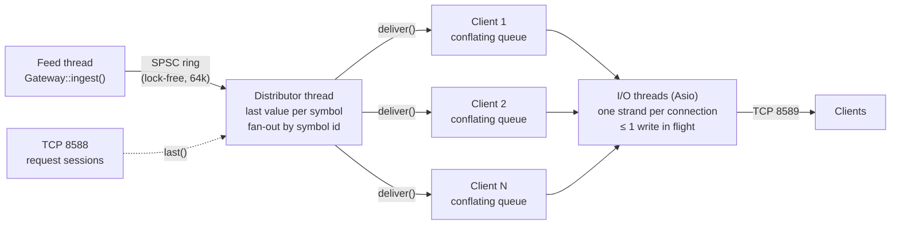

# fmdg: Fincept market-data gateway

A standalone C++20 service that takes in one market-data feed and fans it out to
many TCP clients, built around the cases that break naive fan-out servers: slow
consumers, bursty feeds, idle periods, and hostile input. The feed is
[Alpaca's real-time stock stream](#alpaca-feed) over a WebSocket client written for it,
or a synthetic feed for benchmarks. It keeps the dual-port layout of the original TMS
server, rebuilt on Asio (IOCP on Windows, epoll on Linux):

| Port | Connection | Purpose |
| --- | --- | --- |
| **8589** | long | Binary protocol: a client subscribes to symbols once, then updates are pushed to it |
| **8588** | short | Text: one request line in (`PING`, `SNAPSHOT <sym>...`, `STATS`), one reply out, connection closed |

## Contents

- [Architecture](#architecture)
- [Design decisions](#design-decisions)
- [Testing](#testing)
- [Performance](#performance)
- [Build and run](#build-and-run)
- [Limitations and next steps](#limitations-and-next-steps)

## Architecture



**Threads.**
- **Feed thread:** the single producer. It calls `Gateway::ingest()`, which stamps a sequence number and ingest time and pushes the tick into a lock-free single-producer/single-consumer ring.
- **Distributor thread:** drains the ring, records each symbol's last value, and hands the tick to that symbol's subscribers.
- **I/O threads:** run all socket work. Each connection's reads, writes and close run on its own Asio *strand*, so a connection's handlers never run concurrently and the session needs no lock of its own.

**Per-tick path.** `ingest` → ring → distributor → `PushSession::deliver` pushes the tick into the client's conflating queue and, if the client's writer is idle, posts a write onto its strand → `write_next` drains up to 256 ticks into one buffer → one `async_write`.

**Files.**

| File | What it is |
| --- | --- |
| `include/fmdg/spsc_ring.h` | Bounded SPSC ring: wait-free, each index and each cached copy on its own cache line |
| `include/fmdg/conflating_queue.h` | Per-client outbound queue, at most one pending tick per symbol |
| `include/fmdg/distributor.h` | Ring consumer, last-value cache, subscriptions, idle sleep/wake |
| `include/fmdg/latency_histogram.h` | Log-linear (HdrHistogram-style) histogram, ≤ 1/32 relative error, lock-free `record()` |
| `include/fmdg/protocol.h` | Wire format, bounds-checked parsers, stream `FrameReader` |
| `include/fmdg/symbol_table.h` | Symbol name ↔ dense id, capacity-capped |
| `include/fmdg/gateway.h` | Public API: `start`/`stop`/`ingest`/`stats`; config |
| `src/push_session.*`, `src/request_session.*` | The two connection types |
| `src/synthetic_feed.cpp` | Deterministic random-walk feed for demos, tests and benchmarks |
| `include/fmdg/ws_codec.h` | RFC 6455 client side: handshake helpers and frame codec, pure functions over bytes |
| `include/fmdg/alpaca_protocol.h` | Alpaca stream messages: outgoing JSON, simdjson parsing, what each error code means |
| `include/fmdg/alpaca_feed.h` | The Alpaca feed: TLS WebSocket session, heartbeat, reconnect supervisor |
| `src/tls_roots.cpp` | Loads the Windows root store into OpenSSL (which does not read it) |
| `tools/loadgen.cpp` | Load generator and latency benchmark |

### Wire protocol (port 8589)

Every frame is an 8-byte header followed by the body. All integers are little-endian.

| Header field | Size |
| --- | --- |
| body length | u32 (≤ 64 KiB) |
| message type | u16 |
| flags | u16 (bit 0 on a Tick = snapshot) |

| Type | Direction | Body |
| --- | --- | --- |
| 1 Subscribe / 2 Unsubscribe | client → gateway | u16 n, then n × (u8 len, symbol) |
| 3 Subscribed | gateway → client | u16 n, then n × (u32 id, u8 len, symbol) |
| 4 Tick | gateway → client | u32 id, u64 seq, f64 price, f64 size, i64 exchange ts, i64 ingest ts, i64 send ts |
| 5 Heartbeat | both | empty; the gateway echoes it |
| 6 Error | gateway → client | u16 code, u8 len, text; the gateway then closes |

## Design decisions

**Slow consumers are conflated, not queued and not disconnected.** Each client has a
`ConflatingQueue`: while a symbol's tick is waiting to be written, a newer tick for that
symbol overwrites it in place (keeping its place in line). The trade-offs:

- A client that keeps up sees every tick.
- A client that falls behind costs at most one pending tick per symbol it follows, so memory is bounded no matter how long it stalls.
- The slow client never holds up anyone else.
- When it recovers it gets the *latest* value of every symbol, not minutes of stale history.

The alternatives are worse for market data: an unbounded per-client queue grows until
the process dies, and disconnecting slow clients turns a hiccup into a reconnect storm.

**A new subscriber gets the current value first, and sequence numbers never go backwards.**
A subscription immediately delivers each symbol's last value, flagged as a snapshot.
The ordering rule that makes this safe:
1. The distributor updates the last value *before* taking the subscription lock.
2. `subscribe()` delivers snapshots *while holding* that lock.

So a subscriber can see a tick twice, but never an older tick after a newer one. A
mutation test proves the rule matters (M5 below). Snapshots are excluded from the
latency statistics, because their age is not latency.

**Idle without burning a core, wake without a timer.** When the ring is empty, the
distributor spins briefly, then sleeps on a C++20 `atomic::wait`, which `publish()` ends
with `notify_one`. A naive version of this loses wake-ups: the consumer checks the ring,
the producer publishes and sees no sleeper, then the consumer sleeps forever. Here, both
sides write their flag, issue a `seq_cst` fence, and then read the other side's state
(Dekker style), so at least one of them sees the other. `busy_poll` skips the sleep for
the lowest latency.

**One write in flight per connection.** A session's `writing_` flag is set from the
moment a write is scheduled until the writer finds nothing left. `deliver()` posts a
write only when it flips that flag. The writer re-checks its queue after clearing the
flag, which closes the window where a tick arrives just as the writer goes idle
(mutation M3).

**Everything is bounded.**
- Symbols per request (1024), symbol length (32 printable ASCII characters), and frame body (64 KiB).
- Total symbols in the table (`max_symbols`): clients can name symbols, so without a cap one client could grow the table forever.
- Connections (`max_clients`).
- Request lines (4 KiB) and the request timeout (5 s).
- The ingest ring: when it is full, `ingest()` back-pressures the feed instead of dropping silently, and counts the waits.

**Request port closes gracefully.** After replying, the session half-closes and drains
input until the client closes, bounded by the timeout. Closing a socket with unread
input sends a TCP reset, and a reset can destroy a reply the client hasn't read yet.

**Not using Asio's `io_context` for the hot path.** The fan-out runs on a dedicated
thread fed by the ring, so a burst of ticks never competes with socket completions in
the same queue, and per-tick work on the distributor is a hash lookup and a mutex-guarded
queue push.

## Alpaca feed

`AlpacaFeed` connects to Alpaca's stock stream (`wss://stream.data.alpaca.markets/v2/iex`),
subscribes to trades and one-minute bars, and turns each trade into a `Tick` for
`Gateway::ingest()`. It runs on its own thread and `io_context`, as the gateway's single
producer.

**Why the gateway owns the upstream connection.** Alpaca allows one stream connection
per account on most plans; a second one is refused with error 406. The terminal and a
gateway cannot both connect, so the gateway holds the one connection and fans it out.
That is the reason gateways like this exist. The free plan also caps the stream at 30
symbols and offers only the IEX feed.

**Its own WebSocket client, on the same Asio.** Boost.Beast would bring Boost.Asio,
a second copy of the event loop next to the standalone Asio the gateway already uses.
`ws_codec` is RFC 6455 client framing as pure functions: a handshake builder and checker
(the server's `Sec-WebSocket-Accept` must match our key), a masking encoder, and a
decoder that takes bytes split anywhere. The decoder enforces what a client must: server
frames unmasked, no RSV bits, control frames unfragmented and ≤ 125 bytes, continuation
frames only inside a message. It also caps message size from the header alone, so a
hostile length fails before any payload is buffered. No extensions are offered, so
there is no compression to decode.

**One session.** resolve → TCP → TLS → upgrade, under one deadline; then the server's
`connected` → `auth` → `authenticated` → `subscribe`. Then a reader and a writer coroutine
run side by side, joined with Asio's `&&`, so whichever fails first ends the session and
cancels the other. Only the writer writes: auth, subscribe, pongs, pings and the
close reply all go through its queue, so the TLS stream never has two writes in flight.

**Liveness by ping, not by silence.** Outside market hours an IEX symbol can go quiet for
minutes, so "no message for 15 s means dead" (the terminal's watchdog) reconnects a
healthy link over and over. The feed sends a WebSocket ping every 15 s and treats two
intervals without any byte, pong included, as a dead link.

**Errors by code.** Retrying a wrong key only hammers the server, so 402 (auth failed),
409 and 410 stop the feed for good. 406 waits a minute. 405 (symbol limit) is logged
and the session goes on, since earlier subscriptions remain. Anything else, including
dropped connections and timeouts, reconnects. The wait doubles per failure up to 30 s,
with 50–100 % jitter, and goes back to 1 s once a session has authenticated.

**TLS.**
- Certificate and hostname verification are on.
- OpenSSL on Windows does not read the system store, so `tls_roots.cpp` copies the Windows root certificates into it.
- Checked by trusting only an unrelated root (`--ca-file`): the handshake fails with "certificate verify failed".
- Credentials come from `APCA_API_KEY_ID` / `APCA_API_SECRET_KEY` or a file. Never from the command line, which other processes can read. Never logged; a test checks the log for the secret.

**Checked live** (2026-11-04, Alpaca's test stream, which publishes the made-up symbol
`FAKEPACA` around the clock):
- TLS 1.3; connected, authenticated and subscribed within the same second.
- First trade 3 s later; over 45 s, 8 trades and 1 minute bar, with no disconnects or errors.
- `SNAPSHOT FAKEPACA` on the request port returned the latest trade with its exchange timestamp.

## Testing

90 GoogleTest cases (`tests/`):
- Unit tests for every component.
- End-to-end tests over real loopback sockets: subscribe/snapshot/live ordering, unsubscribe, heartbeats, every error path, the symbol and client limits, shutdown, port conflicts, fan-out, the request port.
- Concurrency tests: two-thread ring and queue stress, concurrent interning, sleep/wake transitions, re-subscribe racing publish, and slow-client isolation with a conservation check (`deliveries == ticks_out + conflated`).
- Fuzzed parser input.
- WebSocket codec: the RFC's own examples (handshake key, masked and unmasked "Hello", fragments); the same stream split at random points, down to one byte at a time; every protocol violation a client must reject.
- Alpaca messages: the samples from Alpaca's docs; timestamps checked against `std::chrono`'s calendar; malformed items skipped without dropping their neighbours.
- `AlpacaFeed` against a fake Alpaca server on loopback, one scripted failure per test:
  - a dropped link (reconnect and resubscribe)
  - a wrong key (stops, no retries)
  - 406 (waits the long backoff)
  - a server that never answers the handshake
  - a dead link only pings reveal
  - a quiet link that answered pings keep up
  - a server-initiated close (echoed)

They run clean under Release, Debug (MSVC checked iterators) and AddressSanitizer. The
original 58 survived 30 back-to-back repetitions; the 32 feed tests, 20.

**Mutation testing.** To check that the concurrency tests can actually fail, each
mechanism was broken on purpose and the suite re-run:

| # | Bug planted | Caught by | Detection |
| --- | --- | --- | --- |
| M1 | `publish()` never wakes the sleeping distributor | `NoLostWakeupsAcrossSleepTransitions` | every run |
| M2 | Queue re-queues instead of replacing a pending tick | 3 conflating-queue tests + slow-client test | every run |
| M3 | Writer goes idle without re-checking its queue | `PingPongNeverStrandsATick` | ~50 % of runs |
| M4 | Distributor sleeps without re-checking the ring | `NoLostWakeupsWhenSleepingAfterEveryPoll` | every run |
| M5 | Last value updated after fan-out instead of before | `ResubscribeRacingPublishNeverGoesBackwards` | ~20 % of runs |

M3 and M5 are nanosecond-wide races, so their tests are probabilistic. Repeating the
suite catches them; a single run might not. M3 and M4 had dedicated tests added after
the first mutation run showed that the general tests missed them.

## Performance

**Setup.**
- AMD Ryzen 9 8945HX (16 cores / 32 threads), Windows 11, MSVC 19.44, Release build.
- Gateway and load generator on the same machine over loopback, each with the stated number of I/O threads.
- Synthetic feed over 100 symbols, every client subscribed to all of them. 8-second measured window after a 1-second warm-up; single runs, which vary by about ±10 % between runs.
- Latency is measured on the machine-wide monotonic clock:
  - **Internal:** `ingest()` → frame handed to the socket.
  - **End-to-end:** `ingest()` → bytes received by the client process.
- `bench/run_bench.sh` reproduces every number below.

**Latency vs fan-out** (light load: 10k ticks/s, 4 + 4 I/O threads, µs):

| Clients | Internal p50 | Internal p99 | End-to-end p50 | End-to-end p99 |
| --- | ---: | ---: | ---: | ---: |
| 1 | 7.4 | 59 | 23.6 | 127 |
| 1, `busy_poll` | 4.2 | 40 | 20.5 | 115 |
| 10 | 33.8 | 123 | 54.3 | 164 |
| 50 | 160 | 344 | 176 | 360 |

**Overload** (50 clients × 100k ticks/s = 5M deliveries/s, more than loopback TCP can
write on this machine):

| I/O threads | Ticks written/s | Share of ticks a client receives | End-to-end p50 / p99 / p99.9 (µs) |
| --- | ---: | ---: | --- |
| 2 | 3.84 M | 76.8 % | 270 / 606 / 770 |
| 4 | 4.28 M | 85.5 % | 176 / 393 / 516 |
| 8 | 4.35 M | 87.0 % | 176 / 377 / 451 |

Under overload the gateway sheds load by conflation and latency stays bounded. Nothing
queues without limit, the feed is never blocked (`ingest waits` = 0), and every client
still converges to the latest value of every symbol.

**Slow-consumer isolation** (50 clients at 10k ticks/s; 5 of them read only 4 KB every
50 ms, about 80 KB/s, roughly 1/7 of their feed):

| Setup | Fast clients p50 / p99 (µs) | Fast clients receive | Slow clients receive | Slow-client data age, p50 |
| --- | --- | ---: | ---: | ---: |
| No slow clients | 176 / 360 | 99.0 % | — | — |
| 5 slow clients | 160 / 336 | 99.1 % | 11.0 % | 1.71 s |
| 5 slow, `send_buffer` = 16 KB | 164 / 336 | 99.1 % | 10.9 % | 0.64 s |

The slow clients do not move the fast clients' numbers. Conflation bounds what the
gateway queues for a slow client, but the OS socket buffers still hold older data:
capping `SO_SNDBUF` (`--send-buffer`) cut its age by 63 % at no cost to fast clients.

**Distributor ceiling** (unpaced feed, 1000 symbols):

| Clients | Ingested/s | Deliveries/s | Written/s | Limit |
| --- | ---: | ---: | ---: | --- |
| 1 | 11.5 M | 11.5 M | 5.5 M | One socket's write rate; the rest is conflated |
| 10 | 1.29 M | 12.9 M | 11.4 M | Distributor thread, about 77 ns per delivery; full ring back-pressures the feed |

**Where the time goes.** At 50 clients, internal latency grows to 160 µs. My first guess
was the distributor posting a wake-up per client. Temporary instrumentation around the
fan-out loop (10k ticks/s, 8 I/O threads) showed otherwise:

- At 50 clients, the whole fan-out took 8.7 µs p50, 0.2 µs per subscriber. Most sessions already had a write in flight, so `deliver()` was just a queue push.
- At 10 clients, most sessions were idle, and waking each one (an IOCP post) cost about 2.3 µs. The 22.5 µs fan-out was most of that run's internal latency.

So the pipeline itself costs single-digit microseconds (one client: 7.4 µs p50). Past
that, the cost is one `send` syscall per client per write on loopback TCP, spread across
the I/O threads. Going from 4 to 8 threads helps only modestly; the load generator runs
on the same cores and kernel network path, which probably caps the gain. Going further
takes multicast or kernel bypass (see [Limitations](#limitations-and-next-steps)).

## Build and run

Windows (MSVC 2022, CMake ≥ 3.25, Ninja, vcpkg with `VCPKG_ROOT` set):

```bat
cd gateway
cmake --preset win          :: Release; also win-debug, win-asan
cmake --build --preset win
ctest --preset win
```

Asio, GoogleTest, OpenSSL and simdjson come from vcpkg through `vcpkg.json`.

```bat
build\win\fmdg.exe --feed alpaca --alpaca-symbols AAPL,MSFT,SPY  :: gateway + Alpaca's IEX stream
build\win\fmdg.exe --feed alpaca --alpaca-stream test            :: FAKEPACA, around the clock
build\win\fmdg.exe --feed-symbols 100 --feed-rate 10000        :: gateway + synthetic feed
build\win\fmdg_loadgen.exe --port 8589 --clients 50            :: measure it from another terminal
build\win\fmdg_loadgen.exe --embedded --clients 50 --slow 5    :: or both in one process
bash bench/run_bench.sh                                         :: the matrix above
```

The Alpaca feed reads `APCA_API_KEY_ID` and `APCA_API_SECRET_KEY` from the environment,
or from a file given with `--alpaca-credentials FILE` containing those two `NAME=value`
lines. Keep that file outside the repository.

On the request port, any line-based client works, for example `PING`, `SNAPSHOT SYM0000 SYM0001` or `STATS`.

## Limitations and next steps

- **Linux:** a `linux` preset is included, but only the Windows build has been compiled and tested so far. CI on both is the next step.
- **Real feed:** Alpaca trades flow in; quotes are not ingested (a `Tick` carries one price), and minute bars are counted but not stored yet. Next: bars into PostgreSQL through a connection pool, history queries on the request port, and the terminal as a client.
- **Per-client queue:** it uses a mutex and `std::unordered_map`. Dense symbol ids would allow a flat array, but that costs memory per client in proportion to the largest id subscribed.
- **Fan-out at scale:** over TCP, every client costs a `send` syscall per write, which is why exchanges distribute over UDP multicast and latency-critical consumers use kernel bypass. That is a different architecture, not a tuning change.
- **Not built:** authentication and TLS on the gateway's own ports (the upstream Alpaca link is TLS), and per-symbol sequence numbers (today's are gateway-wide, so a client can't detect conflation gaps per symbol).
